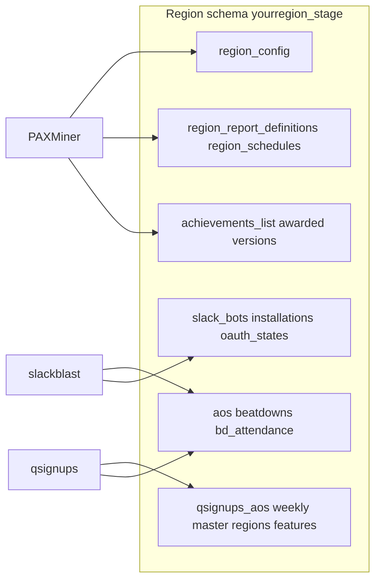

# Architecture

## Monorepo layout

| Path | Purpose |
|------|---------|
| `PAXminer/` | Docker-packaged Lambdas: lightweight Slack Bolt front door, sync, charts, achievements, Kotter (slash/modals on SlackFunction; charts via `files_upload_v2`) |
| `slackblast/` | Zip Lambda + Function URL; Bolt app |
| `qsignups/` | Zip Lambda + Function URL; Bolt app; schedule extension |
| `common/` | Shared `encryption.py`, `token_bootstrap.py` (PAXminer image uses `PAXminer/common/`) |
| `migration/` | One-off migration scripts and env templates |
| `infra/` | Bootstrap CloudFormation (OIDC, SAM artifact bucket) |

Apps do **not** import each other’s Python packages; integration is via **shared MySQL schemas** and env-driven schema names.

## Runtime shapes

- **PAXminer:** Container images, EventBridge schedules, Function URLs for Kotter/interactive and achievements webhook.
- **slackblast / qsignups:** Zip Lambdas, **Lambda Function URLs**, Bolt with `process_before_response` and **lazy listeners** (self `lambda:InvokeFunction`).

- **Future (brother-region Nation attendance):** A shared `external_attendance` table per regional schema could union attendance from partner regions once a Nation API sync exists; Kotter and achievements would read through the same helper as `achievements/attendance.py`.

## Database and schemas

- **One schema per region and stage:** `{F3_REGION_NAME}_{STAGE}`, e.g. `yourregion_prod`. PAXMiner, slackblast and qsignups all read it. `db/migrations` creates every table and view in it.
- **Region row:** `region_config` holds the region's settings, schema name and encrypted Slack tokens.

### Relational overview (conceptual)

### QSignups

These tables live in the region schema:

- **`qsignups_aos`**, **`qsignups_weekly`**, **`qsignups_master`**, **`qsignups_regions`**, **`qsignups_features`**
- **Views:** `vw_master_events`, `vw_weekly_events`, `vw_aos_sort`
- **OAuth (Bolt):** `slack_bots`, `slack_installations`, `slack_oauth_states`

### slackblast

- Uses the region schema for `beatdowns` / `bd_attendance` (ORM `Backblast` / `Attendance`), Slack config, and Strava tokens.
- **Retry receipts** (in the region schema), same idea as two small lock tables:
  - **`welcome_deliveries`** — Slack Events API `team_join` (`event_id` + destination). Stops duplicate welcome DMs/channel posts.
  - **`interaction_claims`** — Slack interactivity `view_submission` (`view.id` + kind: backblast / preblast / strava). Slack retries the same submit when ack exceeds ~3s; each retry is a new Lambda. `beatdowns` / `bd_attendance` uniqueness needs Slack’s message `ts` from `chat_postMessage`, so those PKs cannot lock **before** the channel write. INSERT claim → post; 1062 → skip. Rows older than 7 days are deleted on each claim (own transaction, so a duplicate INSERT does not undo the purge). Do not delete on success — retries still need the row. Missing table fails closed (does not post). Code: [`slackblast/slackblast/utilities/interaction_claims.py`](../slackblast/slackblast/utilities/interaction_claims.py). `db/migrations/0001_baseline.sql` creates both tables.

### Encryption

**`DB_ENCRYPTION_KEY`** (min 16 chars, shared per environment) is stretched (PBKDF2) and used with Fernet-style field encryption (`common/encryption.py` and app-specific copies). Migration and deploy **must** use the same key for a stage.

## QSignups permission model

Resolved in code via [`qsignups/qsignups/permissions.py`](../qsignups/qsignups/permissions.py) using:

- Slack **`users.info`**: `is_admin`, `is_owner`, `is_primary_owner` → **ADMIN**
- Regional **`aos.site_q_user_id`** in **`DATABASE_SCHEMA`** → **AOQ** (Site Q / AOQ)
- Regional **`beatdowns.q_user_id`** (any row) → **Q** (has Q’d a beatdown as primary Q)
- Else → **USER**

| Level | Home tab | Manage Region Calendar | General Settings | AO add/delete | Edit AO / events | Edit any Q slot |
|-------|----------|------------------------|------------------|---------------|------------------|-----------------|
| ADMIN | Refresh + Manage + Settings | Full | Yes | Yes | All AOs | Yes |
| AOQ | Refresh + Manage | Subset (no add/delete AO) | No | No | Own AO(s) only | Yes |
| Q | Refresh only | No | No | No | No | Yes |
| USER | Refresh only | No | No | No | No | Own slot only |

**`DATABASE_SCHEMA`** is required. QSignups cannot connect without it.

## Cross-links

- Deploy and env: **[DEPLOY.md](DEPLOY.md)**
- End users: **[USER_GUIDE.md](USER_GUIDE.md)**
